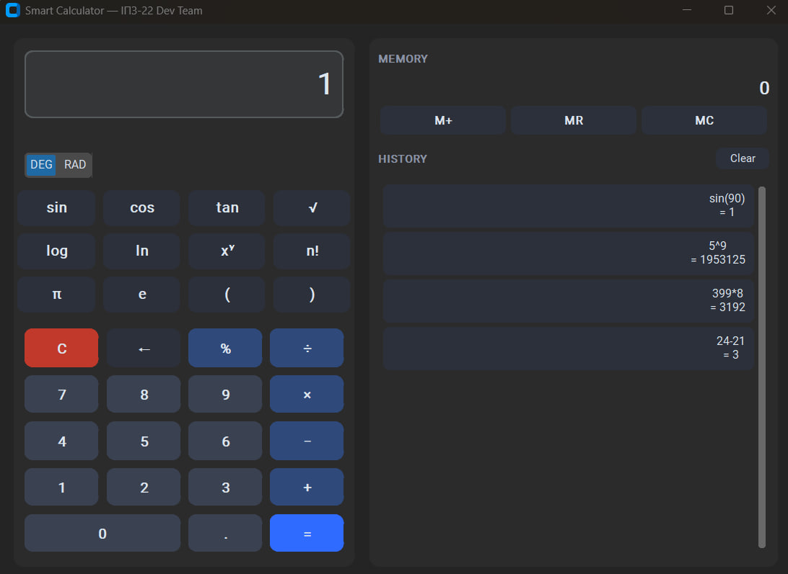

# Smart Calculator

> Науковий калькулятор на Python: власний парсер виразів, графічний інтерфейс CustomTkinter, історія обчислень та пам'ять.

Навчальний проєкт команди **ІПЗ-22 Dev Team**, створений у межах лабораторної роботи 02
з дисципліни «Основи програмної інженерії» (Волинський фаховий коледж НУХТ).

Мета проєкту подвійна: з одного боку — робочий застосунок, з іншого — привід
відпрацювати командний Git workflow (гілки, Pull Request, code review, вирішення
конфліктів, Issues, реліз).



## Можливості

- **Власний парсер виразів.** Вираз розбирається на токени й обчислюється
  алгоритмом сортувальної станції (shunting-yard). Функція `eval()` **не
  використовується** — це і небезпечно, і не показує, як насправді працює
  пріоритет операцій.
- **Пріоритет операцій та дужки** — `2+3*(4-1)^2` дає `29`.
- **Правоасоціативний степінь** — `2^3^2` дає `512`, а не `64`.
- **Унарний мінус** — `-5+3`, `4*-2`, `-(3+2)` обробляються коректно.
- **Наукові функції** — `sin`, `cos`, `tan`, `asin`, `acos`, `atan`, `sqrt`,
  `log`, `ln`, `exp`, `abs`, `fact`.
- **Константи** `pi` та `e`.
- **Перемикач DEG/RAD** для тригонометрії.
- **Історія обчислень** — зберігається у JSON-файл і переживає перезапуск;
  будь-який запис можна повернути на дисплей одним кліком.
- **Пам'ять M+ / MR / MC** — як на звичайному калькуляторі.
- **Зрозумілі помилки.** Ділення на нуль, незакриті дужки, корінь з від'ємного
  числа тощо показуються окремим рядком і **не стирають введений вираз**.

## Технологічний стек

| Компонент | Вибір | Чому саме так |
|---|---|---|
| Мова | Python 3.13 | мова курсу |
| Графічний інтерфейс | CustomTkinter 6.0 | сучасний вигляд поверх стандартного Tkinter |
| Тести | pytest 8.3 | стандарт для Python |
| Контроль версій | Git + GitHub | тема лабораторної роботи |

## Структура проєкту

```text
smart-calculator/
├── main.py                  # точка входу
├── requirements.txt
├── .gitignore
├── core/                    # логіка, незалежна від інтерфейсу
│   ├── tokenizer.py         # розбір виразу на токени
│   ├── evaluator.py         # shunting-yard + обчислення
│   ├── scientific.py        # наукові функції та константи
│   └── history.py           # історія обчислень і пам'ять
├── ui/                      # графічний інтерфейс
│   ├── app.py               # головне вікно
│   └── history_panel.py     # бічна панель: пам'ять та історія
├── tests/                   # pytest
│   ├── test_evaluator.py
│   └── test_history.py
├── docs/screenshots/
└── reports/                 # звіти учасників команди
```

Пакет `core` не імпортує нічого з `ui`, тому логіку можна тестувати без
запуску вікна. Наукові функції передаються в обчислювач **як аргумент**, а не
імпортуються всередині, — завдяки цьому `evaluator.py` не залежить від
`scientific.py`.

## Встановлення та запуск

Потрібен Python 3.10 або новіший.

```bash
# 1. Клонувати репозиторій
git clone git@github.com:Hyrysake/smart-calculator.git
cd smart-calculator

# 2. Створити та активувати віртуальне середовище
python -m venv .venv
.venv\Scripts\activate        # Windows
source .venv/bin/activate     # macOS / Linux

# 3. Встановити залежності
pip install -r requirements.txt

# 4. Запустити
python main.py
```

## Тестування

```bash
python -m pytest -v
```

Наразі проєкт покривають **56 тестів**: токенізація, пріоритет операцій,
асоціативність степеня, унарний мінус, обробка помилок, наукові функції,
форматування результату, історія та пам'ять.

## Команда

| ПІБ | Роль | GitHub | Зона відповідальності |
|---|---|---|---|
| Дмитрук Назар Сергійович | Team Lead | [@Hyrysake](https://github.com/Hyrysake) | `core/tokenizer.py`, `core/evaluator.py`, структура репозиторію, документація, реліз |
| Махнюк Андрій Сергійович | Developer | [@rotterdamsterdam](https://github.com/rotterdamsterdam) | `core/scientific.py`, `ui/app.py`, `main.py` |
| Бардюк Станіслав Олександрович | QA | [@st009bar-dot](https://github.com/st009bar-dot) | `core/history.py`, `ui/history_panel.py`, `tests/` |

Колонка GitHub наведена навмисно: облікові записи учасників не завжди названі повним
ім'ям, тому ця таблиця дозволяє однозначно зіставити автора коміту з учасником команди.

## Git workflow

Команда працює за моделлю **Feature Branch Workflow (GitHub Flow)**:

1. Кожна задача заводиться як **Issue** і прив'язується до віхи `v1.0.0`.
2. Під кожну задачу створюється окрема гілка `feature/<назва>` від актуальної `main`.
3. Готова робота подається як **Pull Request** із текстом `Closes #N`.
4. PR переглядає та схвалює **інший** учасник команди (code review).
5. Після схвалення PR зливається, локальна `main` оновлюється, гілка видаляється.
6. Гілка `main` завжди містить робочу версію застосунку.

Повідомлення комітів — за специфікацією [Conventional Commits](https://www.conventionalcommits.org/uk/v1.0.0/):
`feat`, `fix`, `docs`, `style`, `refactor`, `test`, `chore`.

## Звіти

Звіти учасників з лабораторної роботи 02 — у каталозі [`reports/`](reports/).
