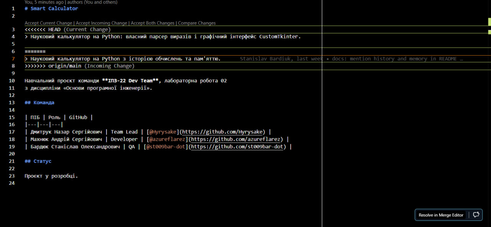

# Звіт з лабораторної роботи 02

## Налаштування середовища розробки та Git workflow

**Виконав:** Бардюк Станіслав Олександрович, група ІПЗ-22
**Роль у команді:** QA

### Інформація про команду

- Назва команди: **ІПЗ-22 Dev Team**

- Учасники:
  - Дмитрук Назар Сергійович (Team Lead)
  - Махнюк Андрій Сергійович (Developer)
  - Бардюк Станіслав Олександрович (QA)

### Опис проєкту

- Тема проєкту: **Smart Calculator** — науковий калькулятор на Python, зібраний з окремих модулів; кожен учасник команди відповідає за власний модуль.

- Розроблені модулі:
  - `core/history.py` — історія обчислень і пам'ять калькулятора (мій модуль)
  - `ui/history_panel.py` — бічна панель історії та пам'яті (мій модуль)
  - `tests/test_evaluator.py`, `tests/test_history.py` — модульні тести (мій модуль)
  - `core/tokenizer.py`, `core/evaluator.py` — розбір та обчислення виразів (Дмитрук Н.)
  - `core/scientific.py`, `ui/app.py`, `main.py` — наукові функції та інтерфейс (Махнюк А.)

- Функціональність кожного модуля:
  - **`history.py`** — мій модуль. Містить два класи. `HistoryStore` зберігає список виконаних обчислень і записує його у JSON-файл у домашньому каталозі користувача, тому історія не зникає після закриття програми. Кількість записів обмежена: коли їх стає більше за межу, найстаріші відкидаються, і файл не росте нескінченно. Окремо продумано поведінку при пошкодженому файлі — якщо вміст не є коректним JSON або має неправильну структуру, калькулятор просто стартує з порожньою історією, а не аварійно завершується. Другий клас, `Memory`, реалізує клавіші M+ / MR / MC: значення накопичується, повертається на дисплей і скидається.
  - **`ui/history_panel.py`** — мій модуль. Бічна панель вікна: показник поточного вмісту пам'яті, три клавіші пам'яті та прокручуваний список історії. Кожен запис історії — це клавіша: натискання повертає результат на дисплей, тож його можна використати в наступному обчисленні.
  - **`tests/`** — мій модуль. 56 тестів на pytest. Перевіряються токенізація, пріоритет операцій, правоасоціативність степеня (`2^3^2` має дорівнювати 512), унарний мінус, ділення на нуль, незакриті дужки, наукові функції та їхні області визначення, форматування результату, збереження й завантаження історії, обмеження кількості записів, поведінка при пошкодженому файлі та всі операції з пам'яттю. Тести історії працюють із тимчасовим каталогом, тому справжній файл історії користувача під час тестування не змінюється.
  - **`tokenizer.py` і `evaluator.py`** — перетворюють текст виразу на токени й обчислюють його алгоритмом сортувальної станції, без `eval()`.
  - **`scientific.py` і `app.py`** — наукові функції з підтримкою режимів DEG/RAD та вікно застосунку на CustomTkinter.

- Технологічний стек: Python 3.13, CustomTkinter 6.0, pytest 8.3, Git, GitHub, VS Code.

### Виконані завдання

- [x] Налаштування Git та GitHub (2FA, SSH-ключ)
- [x] Клонування спільного репозиторію
- [x] Створення Python модулів
- [x] Робота з гілками (для рівнів 2-3)
- [x] Використання Pull Request (для рівнів 2-3)
- [x] Вирішення конфліктів (для рівнів 2-3)
- [x] Робота з Git у VS Code (для рівня 3)
- [x] Файл .gitignore (для рівня 3)
- [x] Створення Issues та releases (для рівня 3)

#### Що конкретно було зроблено мною

1. **Налаштування середовища.** Встановив Git, перевірив версію через `git --version`, налаштував `user.name`, `user.email`, `init.defaultBranch main` та `pull.rebase false`. Зареєструвався на GitHub, увімкнув двофакторну автентифікацію в розділі Password and authentication, створив SSH-ключ `ed25519`, додав публічний ключ (файл `id_ed25519.pub`) у налаштування акаунта й перевірив з'єднання командою `ssh -T git@github.com`. Приватний ключ нікому не передавав і в репозиторій не додавав.
2. **Тренувальний репозиторій.** Виконав вправу рівня 1 у локальному репозиторії `git-practice`: `git init`, створення файлу, `git status`, `git add`, `git commit`, зміна файлу, повторний коміт, `git log --oneline`.
3. **Клонування.** Прийняв запрошення до спільного репозиторію та склонував його через HTTPS. Через SSH не вийшло: ім'я мого користувача Windows записане кирилицею, і SSH-клієнт, що постачається з Git для Windows, перетворював шлях до теки `.ssh` на нечитабельний. HTTPS з входом через Git Credential Manager цю проблему обходить.
4. **Власна гілка.** Створив гілку `feature/history-memory` командою `git switch -c`, написав модуль історії та пам'яті, бічну панель інтерфейсу й набір тестів. Коміти оформлював за Conventional Commits (`feat(history): add JSON-backed calculation history and memory`, `feat(ui): add history and memory side panel`, `test: cover evaluator and history modules`).
5. **Pull Request.** Подав Pull Request #7 із текстом `Closes #2`, рецензентом призначив Махнюка А. Після схвалення PR було злито, після чого я оновив локальну `main` і видалив гілку.
6. **Code review.** Переглянув і схвалив Pull Request #4 Дмитрука Н. з токенізатором і обчислювачем виразів. Схвалення я подав уже після того, як PR злили, тому на практиці побачив, навіщо потрібен захист гілки `main`: без нього GitHub дозволяє злиття без рецензії.
7. **Участь у конфлікті злиття.** Ми з Назаром одночасно змінювали той самий рядок з описом проєкту у файлі `README.md`, кожен у своїй гілці. Мій Pull Request було злито першим, тому конфлікт дістався його гілці; ми розібрали причину разом — Git зупиняє злиття саме тому, що не може сам вирішити, чия версія рядка правильна.

   

   Окрім навчального конфлікту, у моїй гілці виник справжній. Я створив `feature/history-memory` раніше, ніж у `main` потрапив код Назара й Андрія, тому тести падали з `ModuleNotFoundError: No module named 'core.evaluator'`. Після `git merge main` файли `main.py` і `ui/app.py` опинилися в стані `both added`: обидві гілки додали їх незалежно. Я об'єднав версії вручну: зі своєї зберіг підключення панелі історії, з версії Андрія — переклад помилок українською та перевірку на нескінченний результат.
8. **Робота у VS Code.** Створення комітів і перемикання між гілками виконував також через панель Source Control у VS Code.

### Посилання

- GitHub репозиторій: https://github.com/Hyrysake/smart-calculator
- Реліз: https://github.com/Hyrysake/smart-calculator/releases/tag/v1.0.0

### Висновки

Моя роль у команді — QA, тому найбільше я працював не з новою функціональністю, а з перевіркою чужої. Це виявилося корисним: щоб написати тест, треба спершу точно зрозуміти, що саме код має робити. Наприклад, пишучи тест на степінь, я мусив розібратися, чому `2^3^2` має давати 512, а не 64, — через правоасоціативність цієї операції.

Окремо я перевіряв не лише правильні сценарії, а й помилкові: ділення на нуль, незакриті дужки, корінь з від'ємного числа, факторіал дробу, пошкоджений файл історії. Програма має в усіх цих випадках показати зрозуміле повідомлення, а не завершитися аварійно. Саме такі тести знайшли найбільше проблем.

Про Git найважливіший висновок такий: Pull Request — це не бюрократія, а точка, у якій код читає ще одна людина. Коли я переглядав гілку Назара, мені довелося розібратися в алгоритмі сортувальної станції, хоча писав його не я. Тепер код проєкту знайомий мені не лише в межах власного модуля.

Очікувана оцінка: **12 балів**

Обґрунтування: виконано завдання рівня 3. Середовище налаштовано повністю, з двофакторною автентифікацією та SSH-доступом; командну роботу організовано через спільний репозиторій, окремі гілки, Pull Request і взаємний code review; я був однією з двох сторін конфлікту злиття та розбирав його причину разом із team lead; використано інтеграцію Git у VS Code, файл `.gitignore`, ведення задач у GitHub Issues із прив'язкою `Closes #N` і випущено реліз `v1.0.0`. Додатково я покрив проєкт 56 тестами на pytest, включно з перевіркою помилкових сценаріїв. Готовий пояснити будь-який власний тест і будь-яку використану команду Git.
